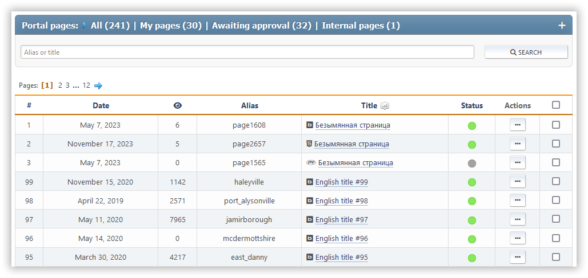

# Manage pages

This section shows all the pages you've created that you can edit. You can search for them by their title or slug: the list is filtered as you type, without reloading the page, and shows how many pages match the current filters. The `*` and `?` characters work as masks — `*` matches any text and `?` matches a single character (for example, `col*r` finds `color-conversion`). All other characters, including `%` and `_`, are searched as is.

Each page shows its ID, creation or last updated date, view count, comment count, page type, slug, and title. You also see a list of actions you can do with it.

The following actions are available for each page:

- Toggle status (enable or disable)
- Edit — change the selected page
- Delete

Mass actions with pages are also available: mark the needed pages with the checkboxes, choose an action (toggle status or delete), and apply it — the list updates right away, without reloading the page.
